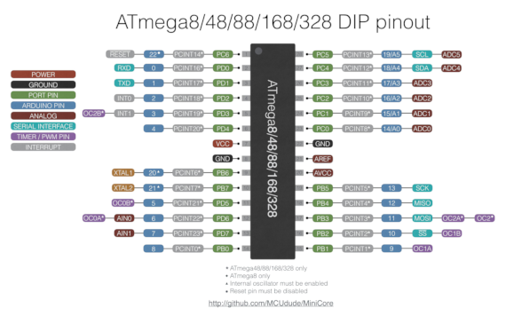
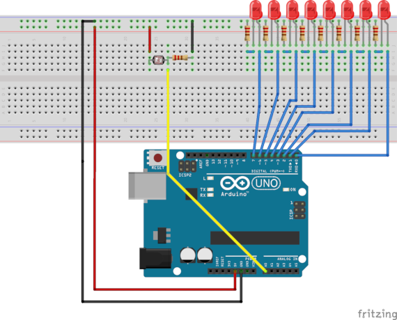

# Light Meter {#a4}

This example presents an AVR based Light Meter that displays its Lux measurements in a Led bank
It also demonstrates the use of the LED, LDR and ADC abstraction objects.
 
 
The pinout of the **ATmega328P** AVR microcontroller is illustrated bellow:



## Hardware

* Arduino UNO
* Light Dependant Resistor (LDR)
* 5 kOhm resistor or a Potentiometer
* A breadboard

## Circuit

The LDR is a passive component. To measure its resistance change we have to send a current in the component between two potentials. We have to create a voltage divider bridge using the LDR and the 5 kOhm resistor. The voltage divider output is
read by the AVR Analog-to-Digial-Converter via pin PC0 (A0 pin in Arduino UNO). The light Lux measurements are displayed in a 
Led bank.


The circuit connection is as follows:



> **Note:** the LED bank occupies all of port D, including PD0 (RxD) and
> PD1 (TxD), the hardware USART pins of the ATmega328P.  With the LEDs
> wired on PD0/PD1 the USART cannot be used at the same time; to combine
> the light meter with serial output, move LED0 and LED1 to other pins
> and keep PD0/PD1 free.


## Code

The following code permits to run the AVR based Light Meter that displays its Lux measurements in a Led bank:


```
#include "Led.h"
#include "ADC.h"
#include "LDR.h"
#include "utils_m328p.h"

#define LED0 0 /**< Led 0 */
#define LED1 1 /**< Led 1 */
#define LED2 2 /**< Led 2 */
#define LED3 3 /**< Led 3 */
#define LED4 4 /**< Led 4 */
#define LED5 5 /**< Led 5 */
#define LED6 6 /**< Led 6 */
#define LED7 7 /**< Led 7 */

#define LDRVD 0 /**< LDR */

// Display range of the light meter in lux, from the GL5528-type LDR
// characteristic that LDR::getLux() implements: LUX_MIN is a dimly lit
// room, LUX_MAX is bright indoor lighting close to a window.  Light
// above the range (direct sunlight) saturates the display, all 8 LEDs
// on; light below it switches all LEDs off.
#define LUX_MIN 1
#define LUX_MAX 1000

int main(void) {

  // Init

  // Instantiate Led objects
  component::Led Led[8]={
        {io::Pin(LED0,io::PortD)},
        {io::Pin(LED1,io::PortD)},
        {io::Pin(LED2,io::PortD)},
        {io::Pin(LED3,io::PortD)},
        {io::Pin(LED4,io::PortD)},
        {io::Pin(LED5,io::PortD)},
        {io::Pin(LED6,io::PortD)},
        {io::Pin(LED7,io::PortD)}};


  // Instantiate ADC object
  core::ADConverter &myADC = core::ADConverter::getInstance();

  // Start conversion
  myADC.start();

  // Instantiate LDR object
  component::LDR LDR(io::Pin(LDRVD,io::PortC),myADC);


  // Mainloop
  while (1) {

    // one measurement per loop iteration
    uint16_t l_lux = LDR.getLux(5);

    // clamp into the display range
    if (l_lux < LUX_MIN)
    {
        l_lux = LUX_MIN;
    }
    if (l_lux > LUX_MAX)
    {
        l_lux = LUX_MAX;
    }

    const uint8_t l_numLeds = static_cast<uint8_t>(utils::map(l_lux,
                                                              LUX_MIN,
                                                              LUX_MAX,
                                                              0,
                                                              8));

    for (uint8_t i=0;i<l_numLeds;i++)
    {
        Led[i].on();
    }

    for (uint8_t i=l_numLeds;i<8;i++)
    {
        Led[i].off();
    }

  }
  return 0;
}

```

## Author

* Farid Oubbati
* Date: 12-May-2018
* Copyright (c) 2018

## License

This project is licensed under the MIT License - see the [LICENSE.txt](LICENSE.txt) file for more details
